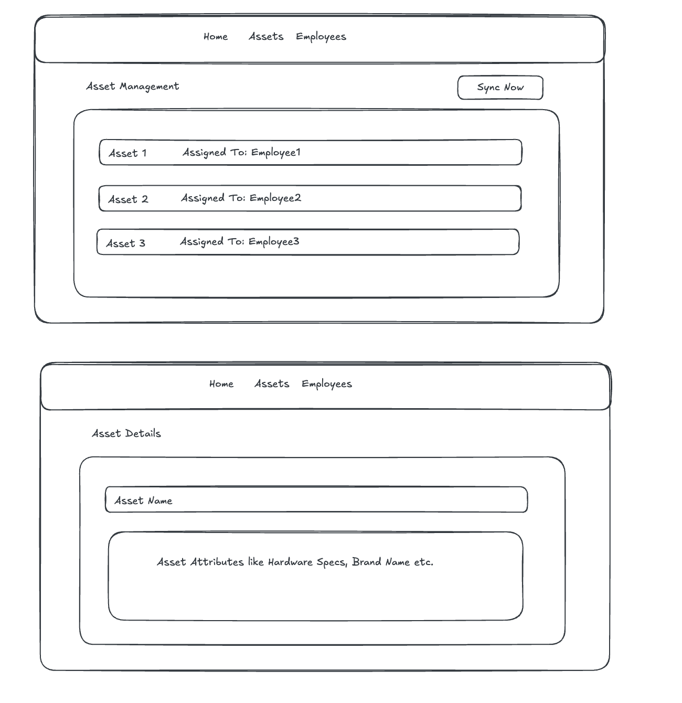

# Fullstack Assignment (6 hours): MDM Device Sync

## Context
WorkWize is an IT hardware management platform. Customers want to import **assigned devices** (devices that have a user) from MDM providers into WorkWize.  
Jamf is the only MDM provider in scope for this assignment, but also think how you can make it easier to implement future MDM providers.

---

## Key Definitions

- **Asset**  
  A device assigned to an employee. Only assigned devices are imported.

- **Asset Attributes**  
  Device specifications such as model, RAM, storage, etc.

- **Employee**  
  A user assigned to a device. Employees are uniquely identified by **email**.

---

## Goals
Create a new repository from this template for your Laravel + React project.

Please make sure the following GitHub users have access to the repository so we can review your work:

- @gumacs92
- @omarsh99

Refer to `files/RefJamfSyncService.php` to understand the code structure and implement an improved version of `JamfSyncService` with enhancements. Use `api-mock-response.json` as the third-party API mock response. Refer **API Flow** section below.

Build a small **Laravel + React** application that can:

- Sync assigned devices from Jamf
- Store assets and employees in **MySQL**
- Show synced assets and employees in a UI list
- The frontend only requires **delete** functionality (no manual create or edit)
- Deleting an asset or employee removes it from the local database only
- Enforce the **MDM Sync Behaviour Rules** listed below



---

## API Flow

### Third-party Jamf API
For this assignment, use the provided mock response file:
- `files/api-mock-response.json`

Your Laravel backend should read this JSON file directly when syncing devices.

### Laravel Backend API
Your React frontend should **not** read the JSON directly.  
Instead, it should interact with your Laravel backend through HTTP APIs.

The endpoints listed below are examples only. You are encouraged to design the API in a way that you think best fits a real-world application.

Example endpoint:

- `GET /api/assets`  
  Returns the synced assets for the UI list.

You may add, remove, or rename endpoints as you see fit. Feel free to introduce additional endpoints, request structures, or response formats if they improve clarity, flexibility, or correctness.

---

## MDM Sync Behaviour Rules

- Asset uniqueness is determined by **serial code**
- Employee uniqueness is determined by **email**
- Unassigned devices (no employee email) must not be imported
- After sync, device details must be visible in the assets list
- If an employee does not exist, it must be created
- Jamf is the source of truth for device assignments
- Re-running sync must recreate deleted assets or employees
- Any changes to device assignment or attributes in the mock response must be reflected after sync  
  _Example: RAM changes from 8GB to 16GB must be reflected after sync_
- Beyond the rules above, feel free to extend the sync logic with any additional behavior you believe is important in a production MDM sync flow (for example edge cases, data integrity, or resilience), and document your assumptions

---

## Running the Application

The application should be **dockerized** and runnable locally using Docker.

- Provide a `docker-compose.yml` that starts the backend, frontend, and MySQL
- The application should be runnable with a single command (for example: `docker compose up`)
- Include basic instructions in the README on how to start the app and access it in the browser
- No production-level setup is required, local development setup is sufficient

---

## Estimated Effort

⏱️ **This task typically takes around 6 hours of focused work**

You are not expected to productionize the setup, but the application should be runnable locally (preferably via Docker).

If you run out of time:
- Document what you would do next
- Call out known limitations or shortcuts

---

# Implementation Notes

This section documents the actual submission: how it's structured, how to run it, and the assumptions made.

## Project layout

```
backend/    Laravel 11 API (PHP 8.3)
frontend/   React 18 + Vite SPA
files/      Original assignment reference material (unchanged)
```

## Running the app

Requires Docker + Docker Compose.

```bash
docker compose up --build
```

- Frontend (React UI): http://localhost:5173
- Backend API: http://localhost:8000/api
- MySQL: exposed on host port **3307** (not 3306, to avoid clashing with a local MySQL install) — not needed to use the app, only if you want to inspect the DB directly.

On first boot, the `backend` container waits for MySQL, then runs migrations automatically (see `backend/docker/entrypoint.sh`). The database starts empty — open the **Assets** page in the UI and click **Sync Now** to import devices from the bundled Jamf mock response.

Both containers bind-mount their source directory for live-reload during development (`vendor/` and `node_modules/` are kept in named Docker volumes so they aren't shadowed by the host mount — see `docker-compose.yml`).

### Running backend tests

```bash
docker compose exec backend php artisan test
```

(Tests use an in-memory SQLite database, so they don't touch the MySQL container or its data.)

## API

| Method | Endpoint             | Description                                             |
|--------|-----------------------|-----------------------------------------------------------|
| POST   | `/api/sync`           | Runs a Jamf sync; returns a summary (created/updated/skipped counts) |
| GET    | `/api/assets`         | List synced assets (with their assigned employee)        |
| GET    | `/api/assets/{id}`    | Asset detail (used by the Asset Details page)             |
| DELETE | `/api/assets/{id}`    | Remove an asset from the local DB only                    |
| GET    | `/api/employees`      | List employees (with `assets_count`)                      |
| DELETE | `/api/employees/{id}` | Remove an employee (and their assets) from the local DB only |

## Architecture: making it easy to add another MDM provider

The sync logic is split so that **nothing Jamf-specific leaks into the generic engine**:

```
app/Mdm/
  Contracts/
    MdmClient.php        — fetch raw device payloads from a provider
    DeviceMapper.php      — map one raw payload -> NormalizedDevice (or null)
  DTO/
    NormalizedDevice.php  — provider-agnostic device shape
  DeviceSyncService.php   — the actual sync engine (DB upserts, the MDM
                             Sync Behaviour Rules). Only depends on the two
                             interfaces above — it has never heard of Jamf.
  Jamf/
    JamfApiClient.php     — implements MdmClient (reads the mock JSON;
                             a real HTTP-based mode is the obvious next step)
    JamfDeviceMapper.php  — implements DeviceMapper for Jamf's payload shape
    JamfSyncService.php   — thin convenience wrapper for DI in the controller
```

`DeviceSyncService::sync()` enforces every rule in **MDM Sync Behaviour Rules** (uniqueness by serial/email, skipping unassigned devices, the provider being the source of truth, re-creating deleted records, reflecting attribute/assignment changes) purely in terms of `NormalizedDevice` objects.

**Adding a second provider** (e.g. Kandji) means writing `KandjiApiClient implements MdmClient` + `KandjiDeviceMapper implements DeviceMapper`, binding the client in `AppServiceProvider`, and handing both to `DeviceSyncService` — no changes to the sync engine, controllers, or database schema. `Asset.provider` already stores which provider each asset came from, and `Asset.attributes` is a JSON column specifically so different providers' hardware specs don't require schema changes.

## Data model

- `employees`: `name`, `email` (unique), `phone`
- `assets`: `serial_code` (unique), `device_name`, `provider`, `external_id` (the provider's own device id), `attributes` (JSON), `last_synced_at`, `employee_id` (FK, cascade delete)

## Assumptions & design decisions

- **Deleting an employee cascades to delete their assets locally.** Every asset in this system exists *because* it's assigned to an employee (unassigned devices are never imported), so an asset with no employee would be an invalid state. Enforced via `cascadeOnDelete()` on the FK. Re-running sync recreates both if Jamf still reports them — Jamf remains the source of truth either way.
- **Fields the provider reports as null don't blank out existing local data** (e.g. an employee's phone, or an asset's missing attributes) — only a value the provider actually supplies overwrites what's stored. Everything else (assignment, device name, attributes present in the payload) is fully overwritten on every sync, since Jamf is the source of truth.
- The bundled `files/api-mock-response.json` has no `storage.disks` field on any device, so `storage_gb` is simply absent from every synced asset's attributes — this is a property of the fixture, not a gap in the mapper (it's fully implemented and covered by a unit test with synthetic storage data).
- All 7 devices in the bundled mock fixture are already assigned to an employee, so the "unassigned devices must not be imported" rule has no example in that file. Rather than editing the provided fixture, this (and the "missing serial number" and "attribute/assignment change" cases) are covered by `backend/tests/Feature/DeviceSyncServiceTest.php`, which feeds synthetic payloads straight into the sync engine.
- No authentication/authorization was added — out of scope for a local-only assignment.
- `POST /api/sync` always syncs from Jamf (the only provider in scope). A provider-selectable sync endpoint is the natural next step once a second provider exists.

## Known limitations / what I'd do next with more time

- `JamfApiClient` only implements "mock" mode. A real mode would add OAuth client-credentials auth, pagination over `GET /api/v1/computers-inventory`, and retry/backoff — all behind the same `MdmClient` interface, so nothing else would change.
- No handling for a device that **disappears** from Jamf entirely (still assigned there, just no longer returned) — it's left in the local DB rather than archived/removed. The rules given don't call for this, but in production I'd add a "seen in this sync" marker and a follow-up step to flag or soft-delete assets that go missing for N consecutive syncs, rather than deleting them immediately on one missed run.
- No pagination on `/api/assets` / `/api/employees` — fine at this data volume, would add cursor/offset pagination before scaling up.
- No request authentication/authorization, rate limiting beyond Laravel's defaults, or structured audit log of sync runs.
- Sync runs synchronously inside the HTTP request; for a larger device fleet this would move to a queued job with progress reporting instead of `POST /api/sync` blocking until done.

